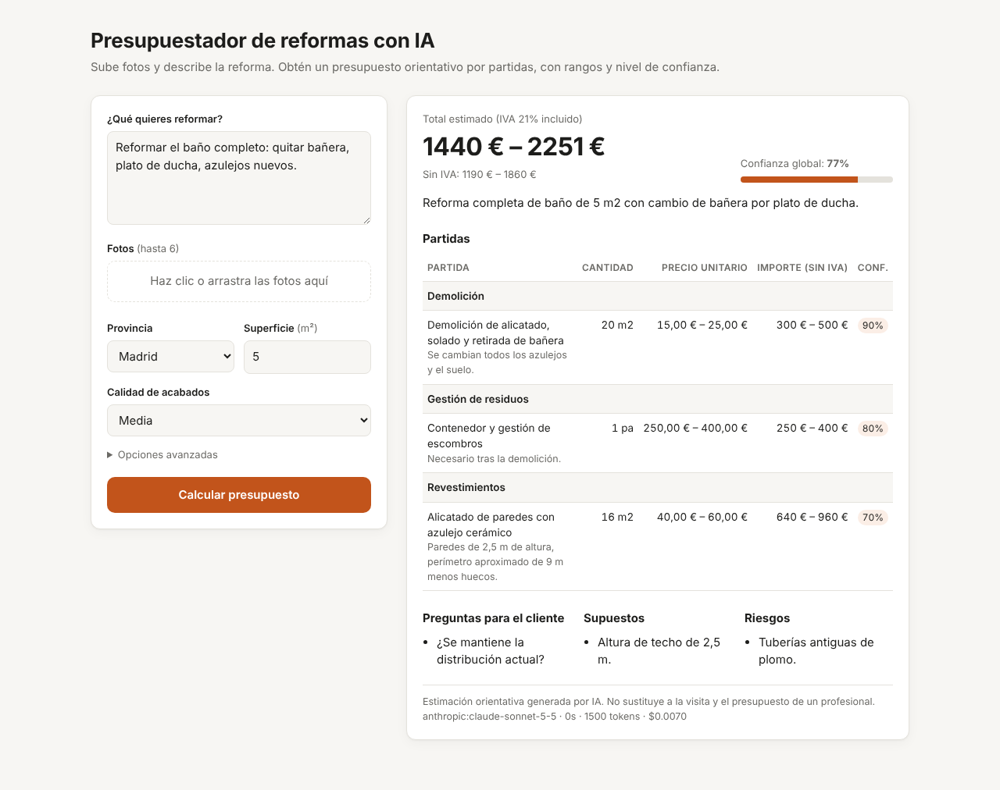
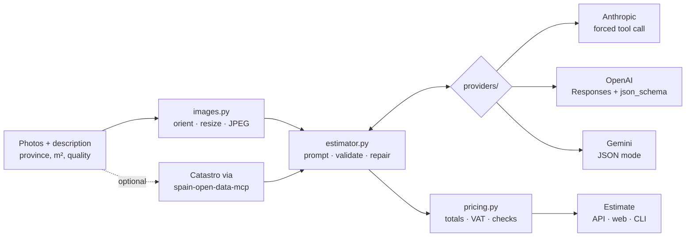

# AI Renovation Estimator

> Photos + a description → an itemised renovation estimate with price ranges, confidence and deterministic checks. Works with Claude, GPT and Gemini, and comes with evals to compare them.

[](https://github.com/gabicuesta/ai-renovation-estimator/actions/workflows/ci.yml)


🇪🇸 [Versión en español más abajo](#-en-español)



## The problem

In home renovation, the first question is always *"roughly how much?"*. Answering it well needs a visit. Answering it badly, with a single number and no breakdown, loses either the client or the margin.

This project explores what a good **pre-visit estimate** looks like when a vision model does the reading and code does the rest:

- **Itemised, like a real quote:** work items grouped by trade, with quantities, units and unit-price ranges.
- **Honest about uncertainty:** ranges instead of single numbers, confidence for each item, explicit assumptions, and the questions that would most reduce the uncertainty.
- **Checked:** every total is computed in code, and deterministic rules flag anything suspicious.
- **Comparable across models:** the same pipeline runs on Anthropic, OpenAI and Google, with an eval set that scores them on quality, cost and latency.

## How it works



1. **Images** are re-oriented, downscaled to about 1.5k px and re-encoded. Vision cost scales with resolution, and the details that matter, like tiles, fixtures or damp stains, survive.
2. **The model returns judgement only:** which work items, quantities, unit-price ranges, confidence, assumptions, questions and risks, all against a strict Pydantic schema.
3. **Validation with one repair attempt:** if the output doesn't match the schema, the validation errors go back to the model once. Tokens from both attempts are counted.
4. **Deterministic pricing:** totals, VAT and a cost-weighted confidence are computed in code, together with checks for:
   - Swapped price ranges
   - Unit prices out of bounds, usually a unit mistake
   - Quantities that don't match the declared area
   - Trades that should come with another one and don't, e.g. demolition without waste removal
   - Ranges that are too wide
   - Low overall confidence

## Design decisions

The full records are in [`docs/adr`](docs/adr).

1. **The model decides *what*, code computes *how much*.** LLMs reason well about scope and add up badly. ([ADR 0001](docs/adr/0001-model-judgement-code-arithmetic.md))
2. **Prices come from the model, with guardrails.** There is no price database: that keeps the project open and shows how far a model's own knowledge goes, which the evals measure. ([ADR 0002](docs/adr/0002-model-prices-with-guardrails.md))
3. **Vendor-neutral by construction.** Thin HTTP adapters, no SDKs, and one validation path for every provider, so models are compared on equal terms. ([ADR 0003](docs/adr/0003-multi-provider-without-sdks.md))

## Quick start

```bash
git clone https://github.com/gabicuesta/ai-renovation-estimator && cd ai-renovation-estimator
uv venv && uv pip install -e ".[dev]"
cp .env.example .env   # add at least one API key
```

**Web + API:**

```bash
uvicorn reno_estimator.api:app --reload
# open http://localhost:8000 · API docs at http://localhost:8000/docs
```

**CLI:**

```bash
reno-estimate "Reformar baño completo, cambiar bañera por plato de ducha" \
  --photo bano1.jpg --photo bano2.jpg --province Madrid --area 5 \
  --model openai:gpt-6.1-sol
```

**Models** use the format `provider:model`, and an empty model means the provider's default:

| Provider | Default | Env var |
|---|---|---|
| `anthropic` | `claude-sonnet-5-5` | `ANTHROPIC_API_KEY` |
| `openai` | `gpt-6.1-sol` | `OPENAI_API_KEY` (and optionally `OPENAI_BASE_URL`) |
| `gemini` | `gemini-3.8-flash` | `GEMINI_API_KEY` or `GOOGLE_API_KEY` |

To add property context from the Catastro (year built, use, area), install `pip install -e ".[catastro]"` and pass `--catastro <reference>`. In the web form it's under "Opciones avanzadas".

## Evals

```bash
reno-evals --models anthropic: openai: gemini: --repeats 2
```

This runs the cases in [`evals/cases.yaml`](evals/cases.yaml) against each model and writes a Markdown and JSON report to `evals/results/`:

| Metric | Meaning |
|---|---|
| **Valid** | Schema-valid estimate, with at most one repair attempt |
| **Chapter recall** | Share of the trades a professional would include |
| **Hit rate** | The midpoint of the estimate falls inside the reference range |
| **Range IoU** | Overlap between the estimated range and the reference range |
| **Spread** | High ÷ low. How decisive the model is |
| **Warnings/run** | Deterministic checks raised |
| **Latency / cost** | p50 latency and total USD |

The reference ranges are **orientative bands**, not ground truth. If you have real closed quotes, put them in that file: that's where the evals become valuable.

## Tests

```bash
pytest           # 30 offline tests: pricing rules, provider wire formats, repair loop, API, evals scoring
ruff check . && ruff format --check .
```

All provider tests run against recorded wire formats with `httpx.MockTransport`. No API key is needed.

## Limits

- It's a **pre-visit estimate**. It doesn't replace an on-site survey. Hidden conditions like plumbing, structure or asbestos can't be seen in photos, so they appear as `risks`.
- Prices reflect the model's knowledge and drift over time. The evals and the reference ranges are how you notice.
- VAT defaults to 21%. Some housing renovations qualify for 10%, so check your case.

## Roadmap

- [ ] Real price anchoring: optional catalogue of unit prices, updated with INE construction cost indices
- [ ] Image evals: a set of photographed cases with closed quotes
- [ ] Streaming partial results to the web UI
- [ ] Prompt caching and batch mode for cost-sensitive volumes

## License

MIT.

---

## 🇪🇸 En español

**Fotos + una descripción → un presupuesto de reforma por partidas, con rangos de precio, confianza y controles deterministas. Funciona con Claude, GPT y Gemini, e incluye evals para compararlos.**

La primera pregunta en cualquier reforma es *"¿cuánto me costará, más o menos?"*. Este proyecto explora cómo es una buena **estimación previa a la visita**:

- **Desglosada como un presupuesto real:** partidas por capítulo, con cantidades, unidades y rangos de precio unitario.
- **Honesta con la incertidumbre:** rangos en vez de cifras únicas, confianza por partida, supuestos explícitos y las preguntas que más reducirían la incertidumbre.
- **Revisada:** los totales se calculan en código y una serie de reglas señala lo sospechoso, como unidades mal puestas, cantidades que no cuadran con la superficie o capítulos que faltan.
- **Comparable entre modelos:** el mismo flujo funciona con Anthropic, OpenAI y Google, y un set de evals los puntúa por calidad, coste y latencia.

**Principio clave:** el modelo decide *qué* hay que hacer; el código calcula *cuánto* cuesta en total.

**Arranque rápido:** `uvicorn reno_estimator.api:app` y abre `http://localhost:8000`.

**Evals:** `reno-evals --models anthropic: openai: gemini:`. Los rangos de referencia son orientativos. Con presupuestos reales cerrados, las evals se vuelven de verdad útiles.

> Estimación orientativa: no sustituye a la visita y el presupuesto de un profesional.
